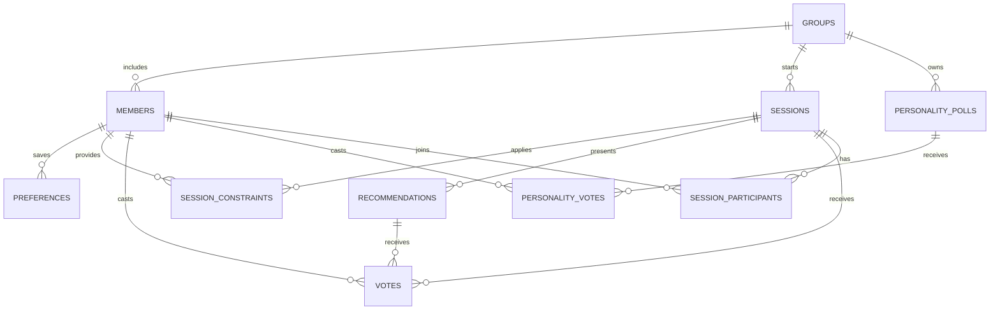

# Foodie AI — Database entities and relationships

This design is for SQLite local MVP; implement migrations and foreign keys. See [spec.md](spec.md) for normative privacy, constraints and session version rules.

Implemented in [`app/persistence/migrations/001_initial.sql`](../app/persistence/migrations/001_initial.sql); diagram source in [`diagrams/er.dot`](../diagrams/er.dot).

## Key entities

- `groups`: UUID primary key, unique iMessage `chat_guid`, group-approved `agent_name`, `personality_json`, default location (optional), radius, onboarding and consent state, settings version.
- `members`: scoped to group, pseudonymized stable sender identity, session/memory opt-in. Never use display names as unique IDs.
- `preferences`: explicitly opt-in persistent preference per member, assertion time and source command.
- `sessions`: one active session per group; status, monotonic `version`, idle expiry, finalized selection, timestamp.
- `session_constraints`: per-member ephemeral needs; `hard` flag and provenance; never overwrite another member's strict need.
- `recommendations`: source provider place ID, session version, stable rank and evidence/freshness metadata; do not persist restricted Places attributes contrary to provider policy.
- `votes`: member and session/poll and stable recommendation identity; uniqueness per voter per active poll.
- `personality_polls`, `personality_votes`: group-approved names and styles, poll open/closed state and one vote per sender.
- `processed_events`: event ID unique; replay protection.
- `outbox`: retry state, session version, expiry, uncertain-send handling.
- `audit_events`: minimized action metadata only, no message bodies.
- `session_participants` (implemented addition): who joined the current session. Used for vote majorities and to apply a member's opt-in saved preferences once when they join.

### Implementation notes

- `members.sender_hash` is HMAC-SHA256(`ID_HASH_PEPPER`, normalized handle), truncated to 32 hex chars. Raw handles are never stored.
- `sessions` has a partial unique index so only one row per group can be in `collecting/searching/shortlist/voting`.
- `sessions.version` increments on every requirement/location change and on end. `shortlist_version` increments for each new list (search, `more`, `closer`); votes are unique per `(session_id, shortlist_version, member_id)`.
- `recommendations.place_json` keeps the normalized OSM fields used to render and give directions (ODbL permits storage; attribution is shown). Deleted on stop/expiry, and for finished sessions after `retention_minutes` (default 60).
- `groups.pending_city*` holds a geocoded city until someone confirms it; the default is only written on `confirm`.
- `outbox.state`: `pending -> sending -> sent | uncertain | failed | discarded`. `sending` rows found at startup become `uncertain` and are not resent.
- `processed_events` is purged after 30 days; dormant messages never create rows.

## Retention

Dormant message bodies are discarded before any storage (implemented: dormant messages don't even record an event id). Temporary session message content should not be durably stored; session constraints expire on finish/timeout. Permanent preferences are only kept after sender opt-in and removed by `Foodie forget me`. Remove group data with an authorized command; preserve only necessary non-content operational tombstones if required for replay protection. Protect secrets and identity hash peppers outside Git.
