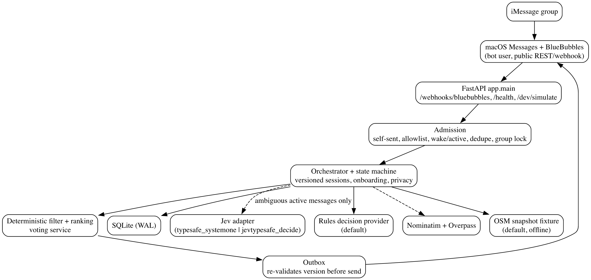
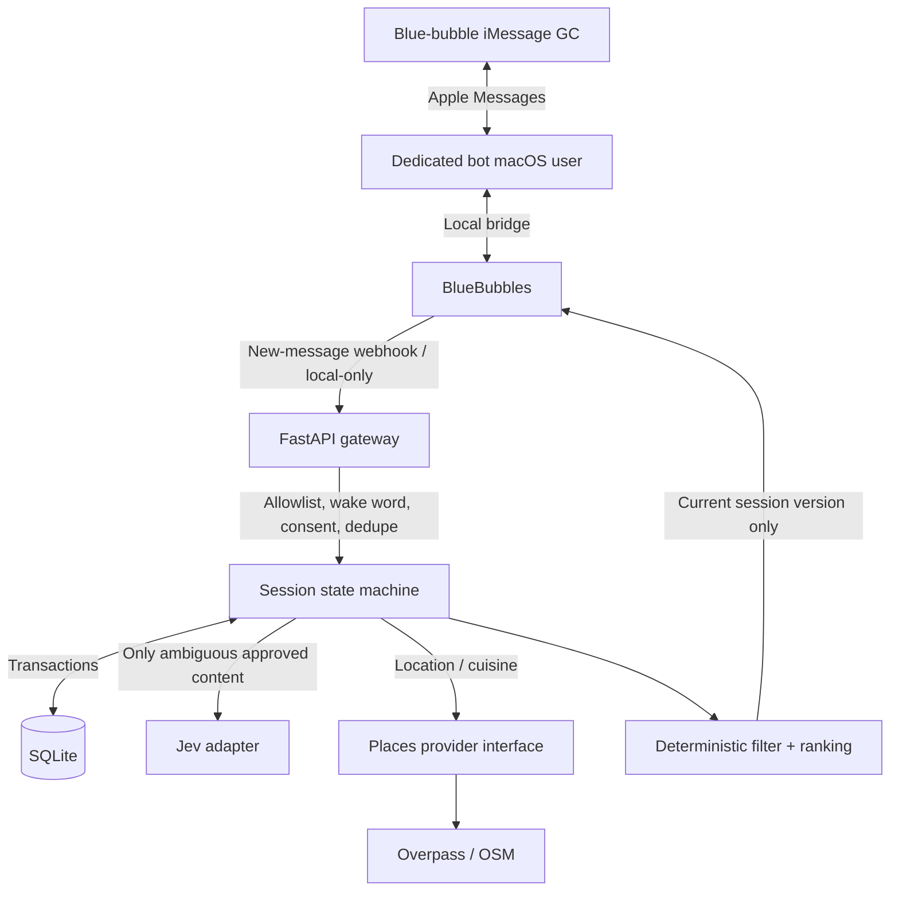
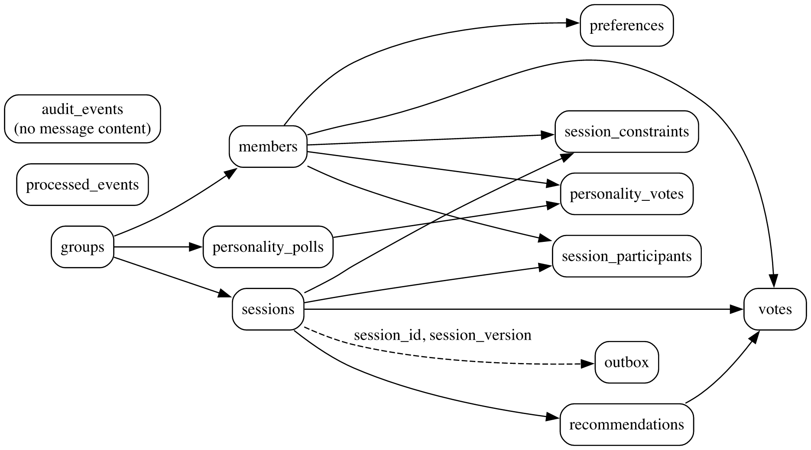
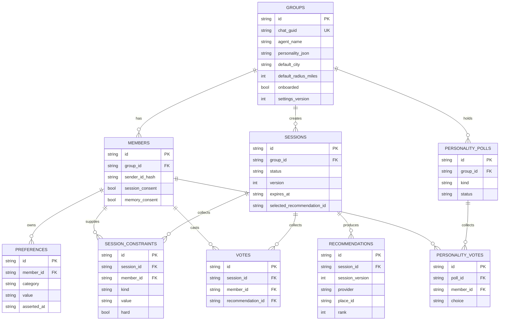
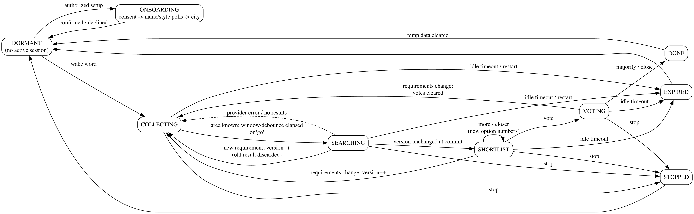
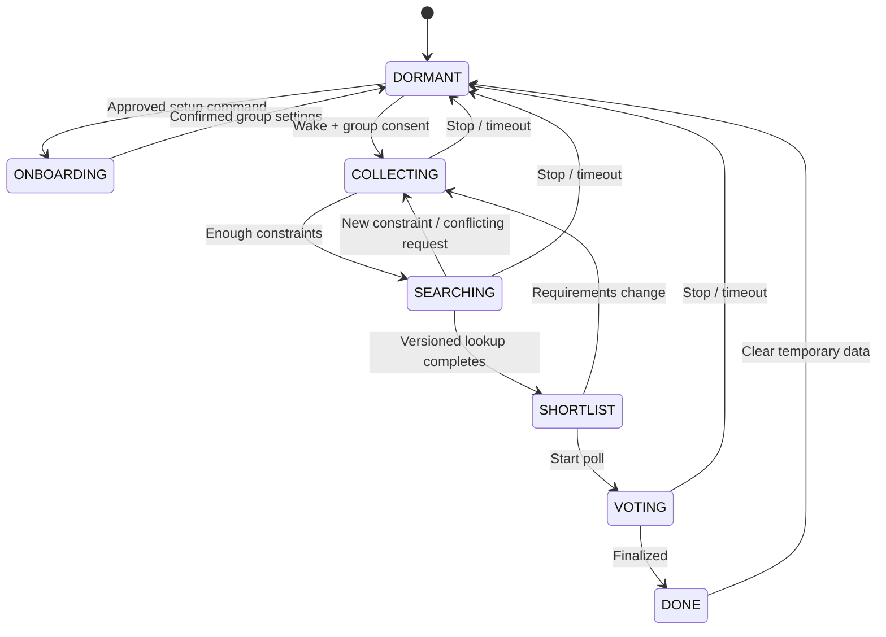

# Foodie AI

**A privacy-aware, on-demand restaurant recommendation agent for existing blue-bubble iMessage group chats.**

> **Status: specification / local-first MVP, not yet a deployed product.** This document (formerly the root README) is both the product requirements document and the implementation contract for Codex. Implement working features incrementally. Never imply a feature works before its tests and integration checks pass.

## Implementation status (2026-10-26)

| Area | Status |
|---|---|
| Offline backend: FastAPI, SQLite, sessions, onboarding, privacy, ranking, voting, outbox | Implemented; 120 pytest tests pass |
| Offline demo without Apple hardware or credentials (`python scripts/demo.py`) | Runs end to end |
| Live geocoding (Nominatim) | Verified once against the live service |
| Live place search (Overpass) | Mock-tested only; public server was at capacity (502/timeout) when checked |
| Jev adapter (both documented schemas) | Mock-tested only; no credentials yet |
| BlueBubbles adapter / real iMessage round trip | Mock-tested only; **blocked** until the bot account + BlueBubbles are set up |

**Implemented chat commands** (prefix with `Foodie AI`, `Foodie`, or the group nickname): `setup`, `agree` / `decline`, `name <X>`, `style <adaptive|chill|funny|direct|custom: ...>`, `close vote`, `city <place>`, `radius <miles>`, `confirm`, `skip city`, `go`, `vote` / `vote <n>`, `more`, `closer`, `directions <n>`, `reviews <n>`, `drop my <budget|radius|cuisine|diet|allergy|avoid>`, `reopen`, `rename`, `change style`, `remember <need>` + `confirm remember`, `forget me`, `privacy`, `help`, `stop`, `erase group` (organizer). During an active search, members who opted in can also just say needs ("halal for me", "$15 is a hard max", "5 miles max", "actually wings instead").

Details, commands and measurements: [docs/implementation-log.md](implementation-log.md). Mac/BlueBubbles/Jev steps: [docs/mac-setup.md](mac-setup.md).

## 1. Mission and non-negotiable requirements

Someone adds the Foodie AI Apple Account email to their existing iMessage group. When an authorized group member calls `Foodie` (or the group's chosen nickname), the agent begins a short dining-planning session, interprets the group's needs with **Jev**, finds **real** restaurants near an agreed location, filters hard constraints, ranks viable options by group fit, time, reviews (when provided), distance and price, returns **at most three** restaurants with **Google Maps links**, and optionally runs a vote. Outside authorized sessions, it does not process group conversation content beyond the minimal local wake-word/stop checks.

**Non-negotiables:**

- **Blue-bubble iMessage only** for real-world integration. Use macOS Messages + BlueBubbles and a separate Apple Account identity (email is acceptable). **Do not** implement an SMS/Twilio fallback or promise an official Apple bot API. Never disable SIP.
- **Local-first / near-$0 development:** Intel Mac, Python, SQLite, mocked adapters, and low-volume OpenStreetMap/Overpass. **Jev is a hosted API and may require payment**; never use a paid provider without an explicit configured key and enabled flag. Everything except real Jev decisions and live iMessage must run in a free mock mode.
- **Jev is required as an implemented adapter**, not an optional hand-wavy future idea. Implement real authenticated requests behind a configurable provider interface, with tests that exercise mocked HTTP responses, timeouts, bad answers, 401/429/5xx, and safe fallbacks.
- **Strict privacy:** only allowlisted and onboarded groups; onboarding disclosure/approval, explicit personal memory opt-in, deletion, retention limits. Even in dormant mode, macOS Messages / BlueBubbles inherently receive messages; *the Foodie app must discard irrelevant content before storage or external calls*.
- **Efficiency first:** deterministic command routing before Jev, one batched decision call when necessary, minimal request context, short debounce for bursts, bounded concurrency, provider timeouts, in-flight job supersession, observability. Do not blindly rerun expensive searches.
- **Truthful restaurant data:** never invent hours, ratings, prices, travel time, menu offerings, halal certifications, allergy safety, open-now, reservations, or Maps URLs. Use `unknown` when a provider doesn't have a field. Hard safety constraints cannot be voted away or silently relaxed.
- **Personalization by group:** `Foodie AI` is the universal base name; nickname/wake word and approved conversational personality are per-group and determined by group vote. No default emoji spam, forced slang, or unnecessary AI chatter.

## 2. User-facing experience

### First-time setup

1. Owner sets up a separate Apple Account in macOS Messages and verifies an actual blue-bubble exchange with a friend before connecting automation.
2. A group adds the bot identity. Since group join events can be unreliable, an authorized participant sends `Foodie AI setup` in an allowlisted test group.
3. Foodie introduces itself **once**, briefly explains what it will process and whether Jev is enabled, and asks the group to opt in to sessions.
4. Group votes on nickname (e.g. `Chef`) and personality (`adaptive`, `chill`, `funny`, `direct`, or approved custom description). A simple explicit-majority rule applies to submitted votes; ties leave the previous/default choice. Keep the voting window configurable; an organizer can close it. Do not silently infer consensus.
5. Ask for a city or neighborhood, propose a default search radius (5 miles; max 15 unless group asks), and save the default **only after confirmation**.
6. Go dormant. Do not auto-read prior chat history.

### Example — a normal dinner decision

```text
Alex: Chef find us dinner near Tempe, under $25.
Chef: I'll look around Tempe. Any dietary requirements for tonight?
Sam: Halal for me.
Mike: No seafood.
Chef: Got it. I'll treat halal as a requirement and avoid seafood.
[After real lookup]
Chef: Here are the best matches I could verify:
1. <real restaurant> — <available rating/review count> — <distance, if known>
   <actual opening-hour/arrival information or "hours not confirmed">
   Why: <short, evidence-based fit reason>
   Map: <actual clickable Maps URL>
2. ...
3. ...
Reply `Chef vote 1`, `Chef more`, or `Chef closer`.
```

Only render actual returned places; one or two places is preferable to fabricated fillers. No real-time location is read automatically from the iMessage group. Search uses explicitly supplied/saved places; Maps directions from each participant's device can resolve their own current location **without Foodie knowing it**.

### Tone

- Group-approved personality provides style boundaries; adapt to the *active* conversation, not unconsented chat history.
- Default reply length 1–2 sentences except shortlists/necessary safety caveats. No emojis by default.
- If upset, frustrated, rushed or discussing allergies, be direct rather than joking.
- Never pretend to be human. The bot identity and onboarding clearly disclose it's AI-assisted.

## 3. Architecture





**Important integration limitation:** BlueBubbles is unofficial and the bot's macOS Messages identity must remain active. A second macOS user may be required to keep the bot separate from the owner's personal identity. If this fails to function on the available Intel Mac, keep the `MockMessagingProvider` working and document the blocker; **do not silently send as the owner's account**.

**Adapters:** `MessagingProvider`, `DecisionProvider`, `PlacesProvider`, `Geocoder`, `TravelTimeProvider` (optional). Keep network I/O outside the deterministic domain code. This lets the backend later move to cloud hosting with only a thin Mac gateway remaining.

### Stack

- Python 3.11+ recommended (verify supported version on the actual Intel macOS; do not force an upgrade that breaks the machine).
- FastAPI + Uvicorn, `httpx` for async HTTP; Pydantic settings and validation; SQLite via `aiosqlite` or safe short transactions with `sqlite3` (choose one and explain); pytest + pytest-asyncio, respx or HTTP mocks.
- BlueBubbles Mac server in **standard public REST/webhook mode only** (never optional Private API / disable SIP).
- Jev structured decision API (hosted, `choice`/`score`/`noul` per verified provider docs).
- OSM Nominatim-compatible geocoding **subject to service terms/rate limits** and Overpass for small prototype searches, with a fixture/mock provider that is always testable offline. Restaurant review counts and trustworthy prices are usually missing from OSM: don't fake them.
- Google Maps links from real provider coordinates/place identifiers using properly URL-encoded HTTPS URLs. Routing/travel duration is **unknown** until a legitimate routing service is integrated; straight-line radius is not driving distance.
- SQLite WAL, foreign keys and migrations. Local file storage under `data/`, excluded from Git.

**Implemented choices:** Python 3.10+ (verified on the target Intel Mac's 3.10.1). Stdlib `sqlite3` with short synchronous transactions behind one lock rather than `aiosqlite`: every statement is a sub-millisecond local write, so a thread hop per query costs more than it saves; per-group `asyncio` locks serialize each chat. Only `persistence/` changes for PostgreSQL later.

## 4. Repository layout Codex should create

```text
foodie-ai/
├── README.md
├── AGENTS.md
├── .env.example
├── .gitignore
├── pyproject.toml
├── app/
│   ├── main.py                    # FastAPI, health & webhook
│   ├── config.py                  # Typed env & safe defaults
│   ├── observability.py           # Stage timings, counters, safe logging (added)
│   ├── domain/
│   │   ├── models.py              # Typed entities/enums
│   │   ├── sessions.py            # State machine, versioning
│   │   ├── commands.py            # Exact wake & high-priority commands
│   │   ├── parsing.py             # Explicit budget/radius/area/cuisine/diet parsers (added)
│   │   ├── conflict.py            # Merge per-person requirements
│   │   ├── ranking.py             # Hard filters, fairness, reviews
│   │   └── replies.py             # Concise deterministic templates
│   ├── messaging/
│   │   ├── base.py
│   │   ├── bluebubbles.py
│   │   └── mock.py
│   ├── decisions/
│   │   ├── base.py
│   │   ├── jev.py
│   │   └── rules.py
│   ├── restaurants/
│   │   ├── base.py
│   │   ├── osm.py
│   │   ├── mock.py                # Offline providers over a REAL OSM snapshot
│   │   ├── hours.py               # Conservative OSM opening_hours parser (added)
│   │   └── maps.py
│   ├── persistence/
│   │   ├── db.py
│   │   ├── migrations/
│   │   └── repositories.py
│   ├── security/
│   │   ├── consent.py
│   │   ├── webhook.py
│   │   └── redaction.py
│   └── services/
│       ├── orchestration.py
│       ├── recommendations.py
│       └── voting.py
├── tests/
│   ├── fixtures/
│   ├── test_commands.py
│   ├── test_privacy.py
│   ├── test_onboarding.py
│   ├── test_sessions.py
│   ├── test_jev.py
│   ├── test_places.py
│   ├── test_ranking.py
│   ├── test_voting.py
│   ├── test_interruptions.py
│   └── test_webhook.py
├── scripts/
│   ├── demo.py                   # Simulated GC end-to-end demo
│   ├── benchmark.py              # p50/p95 by stage
│   └── live_osm_check.py         # One-off manual live Nominatim/Overpass check (added)
├── diagrams/
│   ├── architecture.py           # mingrammer/diagrams source
│   ├── architecture.dot
│   ├── er.dot
│   └── session.dot
└── docs/
    ├── architecture.png
    ├── er.png
    ├── session.png
    ├── data-model.md
    ├── user-stories.md
    ├── mac-setup.md              # Bot account, BlueBubbles, Jev, live OSM guide (added)
    └── implementation-log.md
```

## 5. Entity / relationship model





In migrations also create `processed_events(event_id PRIMARY KEY, received_at)`, `outbox(id PRIMARY KEY, chat_guid, session_id, session_version, payload, state, created_at, expires_at)` and `audit_events` with **non-content** security/action metadata only. `UNIQUE(session_id, member_id)` on votes (per active poll; use a `poll_id` if multiple polls per session). Use stable hashed sender identifiers with a secret pepper; don't treat a casual display name as identity. TTL-purge inactive session raw text and never persist raw dormant messages.

## 6. State machine and interruption rules





**Single active dining session per chat GUID.** Every mutation to location, hard requirements, cuisine, or radius increments `session.version`. Concurrent work stores the starting version; **before sending**, re-read the current session version and status in a transaction and refuse old results. Do not assume canceling an HTTP request is enough. Use `asyncio` locks keyed by group plus durable state and an outbox. A stop command immediately marks the session stopped; external calls may still finish but must never send a reply afterward.

- Prioritize commands `stop`, `forget me`, `privacy`, `help`, `vote`, `setup` with local deterministic routing.
- During an authorized active session, relevant members can share new constraints without repeating the wake word; do not forward irrelevant content to Jev.
- Coalesce ordinary bursts for ~1–2 seconds; never debounce `stop` or privacy deletion.
- If one person changes **their own** preference, update only that person's constraint. If someone says "we all want...", require confirmation before overwriting others' hard requirements.
- If contradictory preferences conflict: hard dietary safety, accessibility, explicitly mandatory budget and strict radius take precedence. Search for creative compromises (mixed menus/food halls) and present the constraint trade-off; never invent a safety-certified match.
- If two people start sessions simultaneously, merge the requests for the same group and occasion; do not send competing results.
- If search is interrupted, mark old version stale and do not send stale shortlist. Votes tied to an invalidated shortlist must be reopened transparently.
- **Idle timeout** defaults to 10 minutes, configurable. A crashed/restarted app must expire stale work rather than replaying old food choices.
- For delivery uncertainty (send succeeds, confirmation lost), do not blindly retry the same iMessage indefinitely. Track bounded retries and flag uncertain sends; prevent reply loops using outgoing message markers.

## 7. Jev adapter: concrete implementation contract

Implement a real `JevDecisionProvider` and `RulesDecisionProvider` under a common interface:

```python
async def decide(session_snapshot: dict, new_message: str) -> Decision:
    """Return validated intent, conflict_type, next_action, confidence, with unknown fallback."""
```

**Important provider ambiguity:** Some online Jev docs identify `POST https://api.typesafe.ai/v1/systemone` with `model`, `state`, `questions`; another provider presents `POST https://jevtypesafe.org/api/v1/decide` with `state`, `questions`. **Do not mix their schemas or silently pick one.** First confirm the user's Jev provider/account documentation and choose the matching adapter/config. Keep `JEV_BASE_URL`, `JEV_ENDPOINT`, `JEV_MODEL` and `JEV_API_KEY` configurable, and write request/response contract tests using sanitized documented fixtures. Official/provider docs: https://jevtypesafe.org/docs/api/ and https://typesafe-jev.ai/jev-api/ .

Use `choice` questions to classify dining intent (`search`, `modify`, `vote`, `unrelated`, `clarify`), conflict (`none`, `cuisine`, `budget`, `location`, `dietary`, `other`) and next action (`search`, `ask_one_question`, `wait`, `ignore`). Batch suitable questions into **one** call with minimized relevant session context. Jev returns bounded decisions, not conversational restaurant facts; validate labels against enumerations, check confidence thresholds and timeout. **Do not rely on Jev to parse arbitrary new free-text entities perfectly**: implement explicit amount/city/cuisine parsers and ask if the result is uncertain. Never send full message history or phone numbers to Jev. Jev should not be used for local wake detection, exact votes, SQL updates, mandatory safety rules, or restaurant ranking.

- `JEV_ENABLED=false` by default: rules provider is used, no network calls to Jev.
- `JEV_ENABLED=true` without API key: fail startup with clear configuration error rather than silently charging/using an unintended provider.
- Bound total API calls per session, timeout each call, no paid retries unless configured; log timings and token count **without raw user messages**.
- 401: fail closed and surface a setup error; 429/5xx: concise local fallback, not infinite retry.

## 8. Restaurant search, location, reviews, hours, maps

**Location priority:** new explicit request > confirmed active-session location > confirmed group default > ask for area. Nobody's live GPS is available simply because they are in an iMessage GC. A user can share a city or parsable Maps link voluntarily; validate it before interpreting coordinates. Do not geolocate phone numbers/IP addresses.

**Range:** default 5-mile radius, configurable maximum 15 miles, hard-limit honored. For normal provider searches, do one reasonably targeted area/cuisine query, filter/sort locally, and broaden only when results insufficient; public Overpass may be slow/rate-limited and results incomplete. Use straight-line Haversine distance for an MVP and label it accurately; provide **driving minutes only if** a real routing service returns them. For groups sharing starting points, later optimize the maximum/median travel time, not merely a geometric midpoint.

**Places interface output:** `provider_place_id`, `name`, `latitude`, `longitude`, `address?`, `cuisine_tags[]`, `rating?`, `review_count?`, `price_level?`, `opening_hours?`, `dietary_evidence?`, `last_fetched_at`, `source_url?`, `maps_url`. Require real coordinates/name. Deduplicate stable provider IDs or same-location/name.

**Filtering order:** explicit mandatory restrictions → expected hours at intended arrival (if available) → strict radius → confirmed budget ceiling (only if actual menu evidence supports it) → rank eligible candidates. **Missing price/allergy/halal data does NOT equal a pass.** If verifying a mandatory requirement is impossible, flag candidate as unverified and avoid presenting it as compliant; tell group what needs restaurant confirmation.

**Ranking:** deterministic, fairness-aware. Proposed starting score across eligible venues: group satisfaction 30%, reviews (Bayesian or review-count confidence weighted) 20%, distance/travel convenience 20%, price comfort 15%, hours fit 15%. Treat unavailable fields as unknown with disclosed lower confidence, not as zero-star reviews. Group satisfaction should consider both the mean individual score and the least satisfied member, e.g. `0.65 * mean + 0.35 * min`. Tests must ensure hard constraints are not outweighed by a high rating. Never fabricate review text; if reviews unavailable on OSM, omit rating/review scoring and normalize known features.

**Reply format:** max three places, each real name, available rating+review count, actual radius distance (labeled straight-line if applicable), verified/unknown hours for target time, price only if known, brief reason, and clickable Google Maps URL. `Foodie more`, `Foodie closer`, `Foodie reviews 2`, `Foodie directions 1`, `Foodie vote` should use current stable shortlist when possible. For review detail retrieval require an authorized provider; no fake excerpts. Maps URLs may use `https://www.google.com/maps/search/?api=1&query=<url-encoded lat,long>` or a verified provider's Maps link.

**Provider compliance:** respect OSM attribution, Nominatim and Overpass service use policies, rate limits, and caching terms. Google Places may require billing and restrict field storage; don't turn it on as part of a $0 MVP. Provider-specific adapters can be added later without changing domain logic.

## 9. Voting and group identity

- One active restaurant vote per sender per session; updates replace that sender's vote. Use stable option numbers tied to a shortlist version so an old `vote 2` cannot silently vote for a new restaurant.
- A vote does not override allergies or another member's hard requirements. Tie → one brief tiebreaker; no repeated nagging.
- Nickname and personality polls have separate IDs, statuses, vote choices and closing rules. Only configured group members vote; duplicates ignored. Custom personality prompts are **style only**, sanitized/length-limited, and cannot modify data-access/privacy/identity/safety rules.
- New member joins during a session: ask whether they are attending, allow their constraints, but don't silently overturn a finalized restaurant. A departure may change active participants after explicit acknowledgement.
- `Foodie AI` always remains a universal fallback wake word even if renamed; allow reset after authorized group vote.

## 10. Webhook & API design

- `GET /health` → minimal health; no secrets or group IDs.
- `POST /webhooks/bluebubbles` → validate origin/secret for local integration, normalize provider message ID, chat GUID, sender, `is_from_me`, timestamp, body; dedupe and queue fast. Never trust text-supplied IDs.
- Local development `POST /dev/simulate` **only if** `APP_ENV=development` and bound to localhost; simulate events for offline demo. Must be disabled in production.
- Keep endpoints for session actions internal service calls, not exposed unauthenticated to LAN/Internet.

BlueBubbles' REST/webhook docs describe new-message and participant events. Confirm the exact payload and send endpoint from the installed server's documented version before coding the live adapter: https://docs.bluebubbles.app/server/developer-guides/rest-api-and-webhooks . No SIP-disabled Private API.

## 11. Configuration and local setup

Codex must generate `.env.example` with **no real credentials**:

```dotenv
APP_ENV=development
HOST=127.0.0.1
PORT=5050
DATABASE_URL=sqlite:///./data/foodie.db
MESSAGE_PROVIDER=mock
BB_BASE_URL=http://127.0.0.1:1234
BB_PASSWORD=
BB_WEBHOOK_SECRET=
ALLOWED_CHAT_GUIDS=
SETUP_SENDERS=
DECISION_PROVIDER=rules
JEV_ENABLED=false
JEV_API_KEY=
JEV_BASE_URL=
JEV_ENDPOINT=
JEV_MODEL=
PLACES_PROVIDER=mock
DEFAULT_CITY=
DEFAULT_RADIUS_MILES=5
MAX_RADIUS_MILES=15
SESSION_IDLE_MINUTES=10
ENABLE_LIVE_SEARCH=false
LOG_LEVEL=INFO
```

A first-run quickstart must work without credentials:

> **iCloud note:** if the repo sits in an iCloud-synced folder (e.g. Desktop with "Optimize Mac Storage"), create the venv as `python3 -m venv .venv.nosync && ln -s .venv.nosync .venv` and set `DATABASE_URL=sqlite:///./data.nosync/foodie.db`, or move the repo out of iCloud. Otherwise imports can hang while iCloud re-downloads files.

```bash
python3 -m venv .venv
source .venv/bin/activate
pip install --upgrade pip "setuptools>=68" wheel   # Python 3.10's bundled setuptools 58 can't do editable installs
pip install -e '.[dev]'
cp .env.example .env
pytest -q
python scripts/demo.py
uvicorn app.main:app --host 127.0.0.1 --port 5050
```

Later switch `MESSAGE_PROVIDER=bluebubbles` **only after** the bot account passes manual blue-bubble send/receive tests and group permission/allowlisting is complete. Only switch `PLACES_PROVIDER=osm` after respecting public endpoint policies and confirming outbound HTTP connectivity. Set Jev values only after confirming provider and budget.

**Mac setup guide:** written in [docs/mac-setup.md](mac-setup.md) (not yet executed on hardware). It covers: (a) dedicated macOS user and Apple Account for bot, (b) test iMessage email identity inside a separate group, (c) install/configure BlueBubbles **without disabling SIP**, (d) bind webhook to local FastAPI, (e) read actual GUID and sender identifiers, (f) limit to a consenting test group, (g) test incoming wake → outgoing blue bubble, (h) stop/revoke and rollback. Do not assume joining a group or an unofficial bridge works on every macOS version.

## 12. Security, consent, and retention

1. Explicit approved-chat GUID allowlist and bot onboarding group consent. The universal `Foodie AI setup` is limited to authorized setup senders.
2. Local gateway must inspect the minimum text required to detect wake/stop. No raw dormant message persistence or external API requests. Recognize the difference between *app processing* and macOS/BlueBubbles's underlying receipt/storage.
3. During active mode, process relevant new messages only. Store temporary structured constraints; expire raw snippets rapidly (prefer not to persist snippets). Only remember personal preferences upon sender's explicit command/confirmation.
4. Expose `Foodie privacy`, `Foodie forget me`, `Foodie stop`, and authorized `Foodie erase group`. Deletion must remove associated preference data; mark necessary minimal tombstones if needed to avoid accidental replay, without copying personal content.
5. Hash member identities with a secret pepper for DB identifiers. Avoid raw telephone/email in logs. No full chat history to Jev; redact other people's personal details.
6. Secrets in `.env`, never tracked in Git; `data/`, logs, caches and credentials ignored. Log only IDs that are safe/hashed, elapsed times, stage outcomes and counts. Rate limit requests and bound retries.
7. Treat chat text and provider results as untrusted. No instruction extracted from a review or message may override system commands, safety checks, or data permissions.
8. Differentiate preferences from medical/allergen safety. Never claim an establishment is safe for severe allergies without direct confirmation; no unverified halal assurances.

## 13. Required tests / acceptance criteria

### P0 (must pass before live iMessage test)

- Dormant, unrelated message → **zero** Jev calls, **zero** stored message bodies, **zero** replies.
- Approved `Foodie` wake → one active session; unauthorized group → no processing.
- `Foodie stop` mid-search → nothing from canceled/stale tasks appears later.
- Once-only onboarding after reboot; no unsolicited message to an unapproved chat.
- Individual `remember` requires consent; `forget me` deletes the correct member only.
- Jev mocked request handles correct provider schema, normal response, low confidence, 401, 429, timeout, invalid JSON, unknown label, and spend guardrails.
- Burst events are deduped; self-sent BlueBubbles webhooks never trigger a response loop.
- Two member messages at once update one session; per-member constraints remain separate.
- New preference during lookup increments version; old results **never** enter the outbox.
- Restaurant shortlist contains only sourced real fixture places, map links valid HTTPS and properly URL encoded, correct distance calculation, no fabricated rating/open status/price.
- Strict radius, budget and dietary requirements cannot be relaxed without appropriate participant confirmation; unknown safety is flagged.
- Vote 2 against an old shortlist version is rejected, not reassigned.
- On restart, stale sessions/jobs expire, idempotent processed-event IDs persist.

### P1 (after foundational MVP)

- Three-way vote tie and close; late joiner; changing time/location; missing reviews/hours; travel-time API missing; OSM timeout, rate limit and empty set; selected restaurant unexpected closure; mixed cuisine compromise; hostile prompt injection; group nickname collision; personality-vote tie; restored outbox delivery uncertainty.

### Benchmark requirements

Use `time.perf_counter()` per stage: webhook admission, classification/Jev, search, ranking, BlueBubbles send, total (where measurable). Export locally reproducible p50/p95/number of observations, cache hit rate, discarded stale requests, Jev requests/session, and failure rates. **Targets only**, not claims: rapid cached responses and live search within seconds under favorable conditions. Never promise universal latency over public Overpass or unofficial iMessage delivery.

## 14. User stories (acceptance-style)

See [docs/user-stories.md](user-stories.md). Codex must implement and test these highest-value stories:

| ID | As a... | I want... | Done when... |
|---|---|---|---|
| US-01 | Group member | Add a blue-bubble assistant | A dedicated Apple Account joins a consenting test group and a genuine iMessage round trip succeeds |
| US-02 | Organizer | Introduce Foodie once | Onboarding cannot repeat on duplicate webhooks or restarts |
| US-03 | Group | Choose a nickname/personality | Group vote saves group-scoped config; fallback wake word works |
| US-04 | Group member | Call Foodie only when needed | Dormant text is ignored; activated sessions accept relevant contributions |
| US-05 | Group | Save usual city | Explicit confirmation saves city; tonight's override doesn't overwrite it |
| US-06 | Attendee | Share my dietary/budget needs | Only my constraints change; hard needs stay hard |
| US-07 | Group | Find real nearby venues | At most three data-backed places, location/radius, Maps links and known/unknown details |
| US-08 | Group | Resolve sushi vs burgers | Agent finds an actual feasible compromise or asks for a vote |
| US-09 | Group | Change from burgers to wings mid-search | Prior search is invalidated and never delivered |
| US-10 | Group | Vote for a shortlist | One member one current vote, stable option identities, clear tally |
| US-11 | Attendee | Remove my persistent data | `forget me` deletes my saved preferences and no others' |
| US-12 | Group | Stop agent immediately | Active processing and late sends cease until next wake |
| US-13 | Group | Recover from Mac/API interruption | No stale recommendations/duplicate messages after reboot |
| US-14 | Reviewer | Run a full demo without Apple hardware | Mock provider simulates onboarding, conflict, search, vote and stop offline |

## 15. Code generation & build order for Codex

**Execute the work; don't just provide a plan.** Implement in this order, with tests at every milestone:

1. Inspect existing repository, preserve useful documentation and diagram source; verify Python environment.
2. Scaffold modules, `pyproject.toml`, `.env.example`, `.gitignore`, formatting/lint/test config, typed domain entities, database migrations and mock adapters. Ensure `pytest -q` works.
3. Implement allowlist/consent, onboarding, nickname/personality poll, reliable dormant/wake/stop state machine; test all P0 privacy rules.
4. Implement idempotent webhook processing, per-group synchronization, versioned session/interruptions, durable outbox; simulate crash/restart tests.
5. Implement restaurant provider interface, deterministic mock fixtures, OSM provider with policy-compliant requests, geocoding and Haversine radius, Google Maps URLs, unknown-data handling; test all ranking cases.
6. Implement group conflict handling, constraint extraction, shortlists and voting; build the offline end-to-end demo.
7. Implement Jev provider adapter with correctly selected provider schema, batched question routing, spend protections and HTTP mocks. Run in rules mode by default.
8. Implement BlueBubbles live adapter from verified installed-version docs, with safe config and a manual test guide. **Do not send actual messages automatically during tests.**
9. Add metrics/benchmarks and structured safe logs. Update architecture diagrams and README to match actual code.
10. Run unit/integration/security tests; provide a concise implementation report: completed, partial, blocked, exact commands executed, test results, known limits, next steps.

### Definition of done for first local MVP

- Can run offline from clone with mock providers, passing automated tests and scripted GC demo.
- On a verified Intel Mac with real bot iMessage identity, wake/stop and reply work through BlueBubbles in a consenting allowlisted group (manual acceptance test; if unavailable report `blocked`, not `passed`).
- With enabled Jev credentials, documented classifier works with provider test fixtures; without credentials the deterministic fallback still works.
- Live OSM mode returns **real** place names and coordinates and honest missing fields; no API key required for small policy-compliant searches.
- Interruptions, constraints, voting, group personality and data deletion have passing deterministic tests.
- `.env` and personal chat data are never checked into the repo; no claims about latency or functionality without actual measurements.

## 16. Diagrams & further documentation

- Architecture image: [docs/architecture.png](architecture.png)
- ERD image: [docs/er.png](er.png)
- Session diagram: [docs/session.png](session.png)
- Data model notes: [docs/data-model.md](data-model.md)
- Detailed user stories: [docs/user-stories.md](user-stories.md)
- Python Diagrams examples: https://diagrams.mingrammer.com/docs/getting-started/examples
- Diagrams installation: https://diagrams.mingrammer.com/docs/getting-started/installation (requires Graphviz)
- BlueBubbles REST/webhook guide: https://docs.bluebubbles.app/server/developer-guides/rest-api-and-webhooks
- Jev docs: https://jevtypesafe.org/docs/api/ and https://typesafe-jev.ai/jev-api/ (verify correct provider before integrating)

**Diagram status:** `diagrams/*.dot` and `diagrams/architecture.py` match the implemented code (stopped/expired states, outbox, participants, rules/snapshot defaults), and the PNGs in `docs/` were re-rendered from the `.dot` files on 2026-10-26. To re-render: `dot -Tpng diagrams/session.dot -o docs/session.png` (same for `er`, `architecture`).

**Diagram policy:** Preserve existing PNGs, include editable `diagrams/*.py` source (mingrammer) and Mermaid in docs. Rerender as architecture evolves; diagrams reflect reality, not future features mislabeled as implemented.

## 17. Future scale path (not an MVP prerequisite)

Swap SQLite → PostgreSQL, local FastAPI → cloud backend, local cache → controlled cache, OSM → licensed Places provider with ratings/opening-hours, optional routing API for real drive times, background queues and durable per-group locks. **A Mac/BlueBubbles gateway is still needed for blue-bubble iMessage** unless Apple provides a supported bot transport. Move the intelligence to the cloud only after the local setup and usage costs are measured. Keep privacy filtering at the Mac gateway rather than forwarding entire dormant conversations remotely.

---

**Project owner guidance:** Build the small, honest, fully tested version first. The goal is a real technical portfolio project: event-driven messaging + Jev typed decisions + group-aware restaurant ranking + privacy and interruption handling. Do not fabricate restaurant data, success metrics, or iMessage compatibility.
